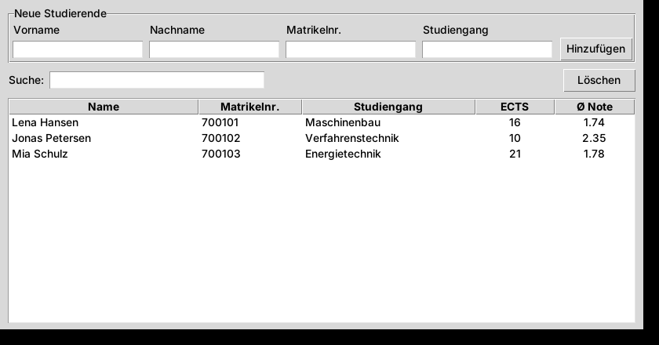

# Campus-Verwaltung

Kleine Desktop-Anwendung in **Python**, mit der Studierende, Module, Einschreibungen und Noten verwaltet werden.
Ein Übungsprojekt zu den Themen **objektorientierte Programmierung, Datenbanken (SQL) und grafische Oberflächen**.



## Funktionen

- Studierende anlegen, suchen (Name oder Matrikelnummer) und löschen
- Module mit ECTS verwalten, Studierende einschreiben, Noten eintragen
- Automatische Auswertung: **bestandene ECTS** und **ECTS-gewichteter Notendurchschnitt**
- Modulstatistik: Teilnehmende und Durchschnittsnote je Modul
- Datenprüfung direkt in der Datenbank (eindeutige Matrikelnummer, ECTS 1–30, Noten 1,0–5,0)

## Technik

| Bereich | Umsetzung |
|---|---|
| OOP | Datenklassen mit Vererbung (`Person` → `Studierende`) und Validierung (`Modul`) |
| Datenbank | SQLite mit Fremdschlüsseln, `JOIN`, `GROUP BY`, gewichtetem Durchschnitt in SQL |
| GUI | Tkinter mit Formular, Live-Suche und Tabelle (`ttk.Treeview`) |
| Tests | pytest mit In-Memory-Datenbank |

## Starten

```bash
python main.py            # grafische Oberfläche (legt Beispieldaten an)
python main.py --bericht  # Auswertung in der Konsole
pytest -q                 # Tests
```

Keine zusätzlichen Pakete nötig – nur Python 3.10+ (Tkinter und SQLite sind enthalten). Die Beispieldaten sind frei erfunden.

## Aufbau

```
campus/modelle.py        Datenklassen (OOP)
campus/datenbank.py      SQLite-Zugriff und Auswertungen
campus/gui.py            Tkinter-Oberfläche
campus/beispieldaten.py  Beispieldaten
main.py                  Startpunkt (GUI oder Konsolenbericht)
tests/                   Unit-Tests
```

Autor: Osama Khalifa
